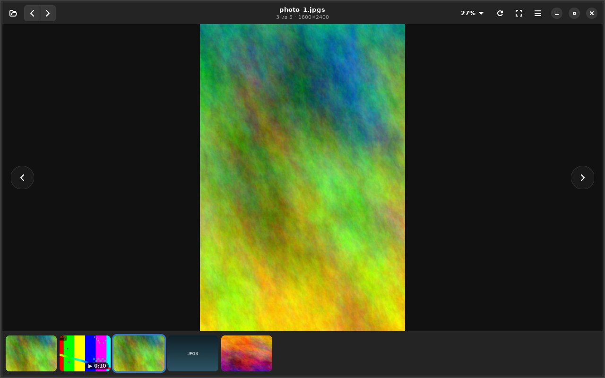
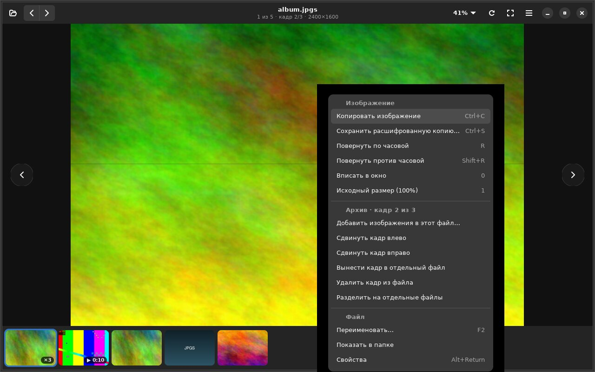
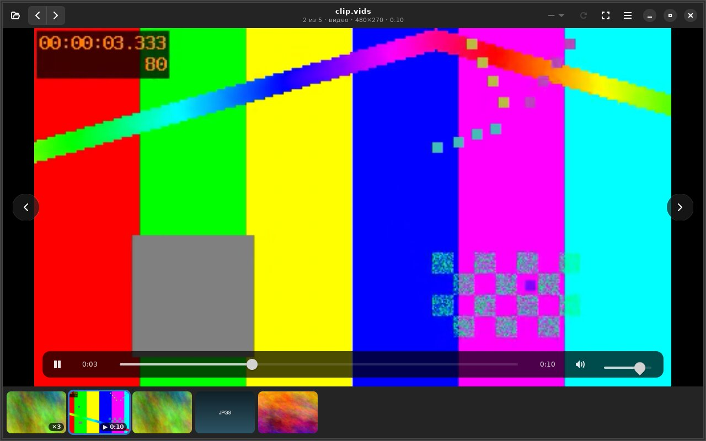
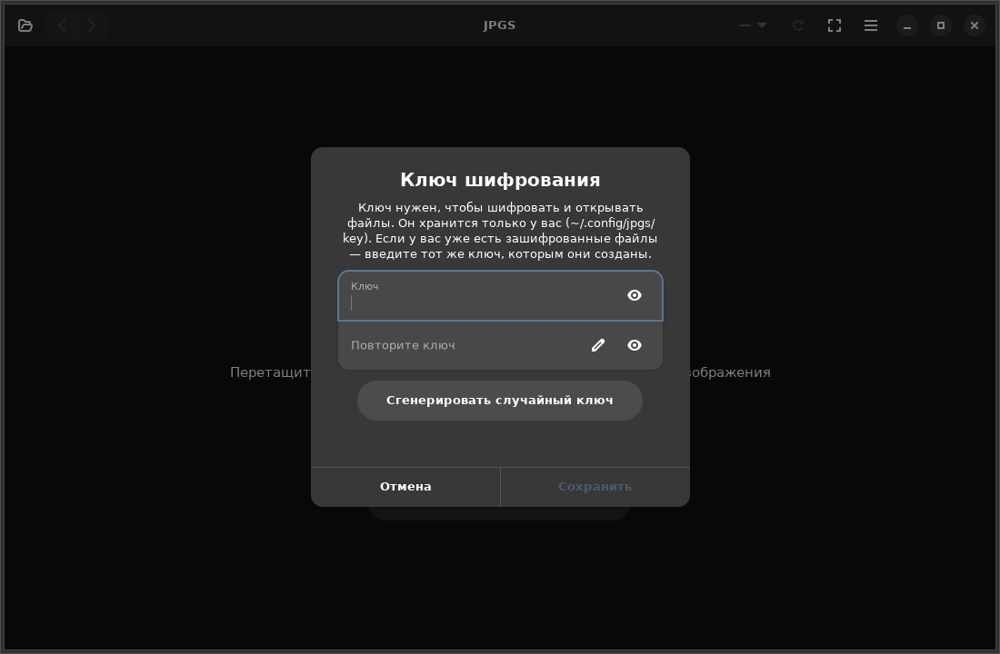

# JPGS — зашифрованная галерея изображений и видео для Linux

**Просмотрщик личных фото и видео, которые хранятся на диске в зашифрованном виде (AES-256).**
Файлы расшифровываются только в памяти: на диск ничего не пишется, в историю системы ничего не попадает.
GTK 4 + libadwaita, нативно под Wayland, видео через libmpv / FFmpeg.

    



## Возможности

**Изображения (`.jpgs`)**
- Листание кнопками ← → (в заголовке и по краям), кликом у края, стрелками; лента миниатюр внизу.
- Масштаб колёсиком к курсору, щипком, клавишами; двойной клик — вписать ↔ увеличить; до 2000%.
- Масштаб и сдвиг считает видеокарта. Кадр декодируется под размер экрана, полное разрешение
  подгружается только при увеличении, соседние кадры — заранее. Листание мгновенное, памяти мало.
- Поворот, учёт EXIF-ориентации, полный экран, слайд-шоу.

**Файл `.jpgs` — это архив кадров.** В одном файле может лежать много изображений:
- перетащите картинку или другой `.jpgs` в окно — кадры **допишутся в открытый файл**, без копий
  и без пересборки;
- правый клик → переместить кадр на нужный номер, удалить, вынести в отдельный файл, разделить
  архив на файлы.

**Видео (`.vids`)** — любые форматы (mp4, mkv, webm, mov…) и анимированные GIF (анимация
сохраняется, GIF крутится по кругу), аппаратное декодирование, звук,
мгновенная перемотка по зашифрованному файлу. Панель управления, скорость, повтор,
сохранение кадра.

**Правый клик** — меню для изображения, архива и видео:



**Интеграция с системой:**
- миниатюры `.jpgs` / `.vids` в Dolphin, Nautilus, Nemo, Thunar;
- пункты «Открыть в JPGS», «Расшифровать сюда», «Зашифровать» в контекстном меню Dolphin / Nautilus / Nemo;
- ассоциация файлов, значки, ярлык в меню приложений.



## Установка

Зависимости: `python`, `python-gobject`, `gtk4`, `libadwaita`; для видео — `mpv` (libmpv) и `python-av`.

**Arch Linux (пакетом):**
```sh
git clone https://github.com/DiabloZet/jpgs.git
cd jpgs
makepkg -si
jpgs set-key          # задать ключ (или программа спросит при первом запуске)
```

**Любой дистрибутив, только для себя (без root):**
```sh
./install.sh          # спросит ключ; удаление: ./uninstall.sh
```

| Дистрибутив | Пакеты |
|---|---|
| Arch / Manjaro / EndeavourOS | `python-gobject gtk4 libadwaita mpv python-av` |
| Debian 13+ / Ubuntu 24.04+ | `python3-gi gir1.2-gtk-4.0 gir1.2-adw-1 libmpv2 python3-av` |
| Fedora 40+ | `python3-gobject gtk4 libadwaita mpv-libs python3-av` |

Нужны GTK ≥ 4.10 и libadwaita ≥ 1.5 (названия пакетов в других дистрибутивах могут немного отличаться).

## Ключи шифрования

Встроенного ключа нет. Ключ задаёт каждый пользователь:
- при установке (`install.sh` спросит),
- командой `jpgs set-key` (`--generate` — создать случайный),
- или в окне программы: при первом запуске либо *Меню → Ключи шифрования…*



Вы вводите обычное слово или фразу — программа выводит из него полноценный 256-битный ключ
(PBKDF2-HMAC-SHA256, 300 000 итераций). Соль фиксированная, поэтому одно и то же слово на другом
компьютере даёт тот же ключ: файлы откроются, даже если не переносить `keystore.json`.

**Несколько ключей.** В окне *Меню → Ключи шифрования…* (или командой `jpgs keys`) можно держать
сразу несколько именованных ключей, переключать активный, переименовывать и удалять их. Активный
ключ используется для новых файлов и при открытии. Ключи хранятся в `~/.config/jpgs/keystore.json`
(права `600`); слово можно задать и переменной окружения `JPGS_WORD`.

**Файлы из прежних версий (до 2.4).** Раньше слово использовалось как ключ напрямую, поэтому
старые файлы открываются «ключом старого формата». Существующий ключ переносится в хранилище
автоматически и продолжает работать. Чтобы перейти на стойкий ключ, не меняя слово:

1. *Ключи шифрования…* → кнопка со щитом у старого ключа (создаст усиленный ключ из того же слова);
2. согласиться перешифровать файлы открытой папки — или позже через «Сменить ключ у всех файлов
   папки…».

Одной командой то же самое:

```sh
jpgs keys list                                        # узнать id старого ключа
jpgs keys upgrade <id> --rekey *.jpgs *.vids --activate
```

Перешифровка идёт поблочно, на диск ничего не расшифровывается. Чтобы просто открыть старые файлы
(например, на другом компьютере), добавьте ключ с галочкой «Ключ из прежних версий JPGS»
(`jpgs keys add --legacy`); переменная `JPGS_KEY` тоже означает старый формат.

**Смена ключа у файлов.** Уже зашифрованный файл можно перешифровать другим ключом, не
расшифровывая его на диск: «Сменить ключ файла…» в контекстном меню, «Сменить ключ у всех файлов
папки…» в меню, или `jpgs keys rekey ФАЙЛЫ --to <id>` в командной строке.

**Пароль на программу (необязательно).** Если задать пароль (*Ключи шифрования… → Пароль* или
`jpgs keys passwd`), список ключей на диске хранится зашифрованным (PBKDF2-HMAC-SHA256 +
AES-256-CBC + HMAC), а сам пароль не записывается — хранится только проверка. При запуске программа
спросит пароль; в скриптах его можно передать переменной `JPGS_PASSWORD`. Пароль необязателен: без
него всё работает как раньше.

Отпечаток ключа (`jpgs key`) помогает сверить, что на двух компьютерах ключ одинаковый.

> ⚠ Без ключа (и без пароля, если он задан) файлы не открыть — сохраните их в менеджере паролей.
> Файлы, зашифрованные одним ключом, другим не открываются. Если забыть пароль, ключи не восстановить.

## Командная строка

```sh
jpgs файл.jpgs                  # открыть окно
jpgs encrypt a.jpg b.png clip.mp4 [-o папка] [--remove]
jpgs decrypt x.jpgs clip.vids [-o папка]
jpgs info *.jpgs *.vids
jpgs encryptor | merge | decoder | recovery   # пакетные команды для текущей папки
jpgs set-key [--generate | --stdin]  ·  jpgs key
jpgs keys list | add [--legacy] | remove <id> | use <id> | rename <id> ИМЯ | passwd [--remove]
jpgs keys upgrade <id> [--rekey ФАЙЛЫ] [--activate]   # усилить ключ старого формата
jpgs keys rekey ФАЙЛЫ --to <id>               # перешифровать файлы другим ключом
```

## Горячие клавиши

| | |
|---|---|
| ← → · PgUp PgDn | предыдущий / следующий кадр |
| Shift+← → | предыдущий / следующий файл |
| колёсико · + − · 0 · 1 | масштаб · вписать · 100% |
| R / Shift+R | поворот |
| F · F11 · Esc | полный экран · выход |
| F5 · T | слайд-шоу · лента миниатюр |
| Пробел · Ctrl+← → · ↑ ↓ · M | видео: пауза · ±10 с · громкость · звук |
| Ctrl+C · Ctrl+S · F2 · Delete · Alt+Enter | копировать · сохранить копию · переименовать · в корзину · свойства |

## Безопасность — честно

- Шифрование: AES-256 в режиме ECB с PKCS#7. Содержимое файлов скрыто, но ECB — не современная
  аутентифицированная схема: она не защищает от подмены данных и не прячет повторяющиеся блоки.
  Для личной галереи на своём диске это приемлемо; для защиты от целенаправленной атаки используйте
  шифрование диска (LUKS) в дополнение.
- Ключ из слова: с версии 2.4 — PBKDF2-HMAC-SHA256, 300 000 итераций, фиксированная соль.
  Фиксированная соль означает, что для JPGS в принципе можно заранее посчитать таблицу для
  словаря частых паролей (ценой 300 000 итераций на слово); это сознательный размен ради того,
  чтобы одно слово работало на любом компьютере. Длинная фраза обесценивает такую таблицу.
  Ключи «старого формата» (файлы до 2.4) устроены как в Java-версии — байты слова, добитые
  нулями; там кандидат при переборе проверяется одним блоком AES, поэтому короткое слово
  подбирается быстро. Такие ключи стоит усилить (см. «Ключи шифрования»).
- **Хранилище ключей** (`keystore.json`) без пароля лежит открытым — оно защищено только правами
  `600`. Само ключевое слово туда не пишется (только готовые байты ключа), но это не защита
  файлов: байты и есть ключ, и кто прочитал хранилище — тот откроет всё. Смысл в том, чтобы не
  оставлять на диске слово, которое могло использоваться где-то ещё как пароль.
  Реально закрывает хранилище только пароль на программу: с ним запись шифруется
  PBKDF2-HMAC-SHA256 (200 000 итераций) → AES-256-CBC + HMAC-SHA256. Слабое место ECB самих
  `.jpgs`/`.vids` это не меняет.
- **Миниатюры** в файловом менеджере хранятся **нешифрованными** в `~/.cache/thumbnails`.
  Если это нежелательно — отключите предпросмотр `.jpgs`/`.vids` и очистите кэш.
- «Сохранить копию», «Расшифровать» и «Копировать изображение» создают незашифрованные данные — только
  по вашей команде.

## Решение проблем

- **Видео: чёрный экран** — *Меню → Упрощённый вывод видео*, перезапустить программу.
- **Нет миниатюр видео** — установите `python-av`, затем `rm -rf ~/.cache/thumbnails/fail`.
- **KDE: нет пунктов меню / миниатюр** — `kbuildsycoca6 --noincremental`,
  `systemctl --user restart plasma-plasmashell`; в настройках предпросмотра Dolphin поднимите лимит размера файла.
- Отладка видео: `JPGS_MPV_LOG=/tmp/mpv.log jpgs файл.vids`.

## Разработка

```sh
python3 -m unittest discover -s tests -v
./bin/jpgs файл.jpgs    # запуск из исходников
```

| Модуль | Что делает |
|---|---|
| `jpgs/crypto.py` | AES (python-cryptography или OpenSSL через ctypes), хранение ключа |
| `jpgs/keystore.py` | несколько ключей, необязательный пароль (PBKDF2 + AES-CBC + HMAC) |
| `jpgs/keys_ui.py` | окно управления ключами, запрос пароля, выбор ключа для перешифровки |
| `jpgs/container.py` | чтение `.jpgs`/`.vids` по блокам, поиск JPEG внутри, архивные операции, потоковое шифрование |
| `jpgs/imaging.py` | декодирование JPEG под размер экрана |
| `jpgs/video.py` | libmpv через ctypes (поток из памяти, OpenGL-рендер), кадры через PyAV |
| `jpgs/viewer.py`, `video_ui.py` | интерфейс |
| `jpgs/cli.py` | командная строка и миниатюры для файловых менеджеров |

## Лицензия

[GPL-3.0 license](LICENSE) © DiabloZet
